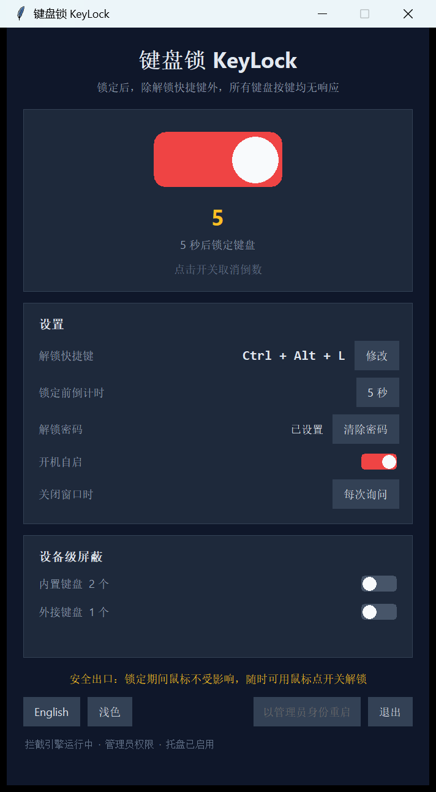
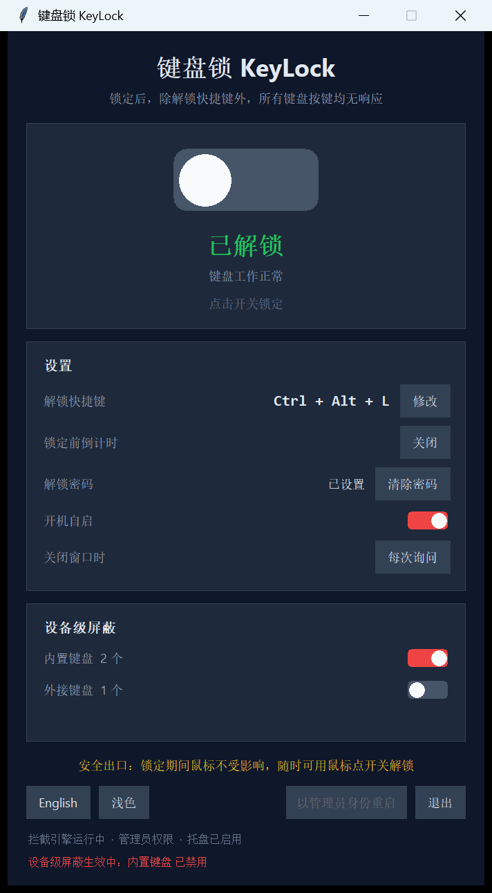
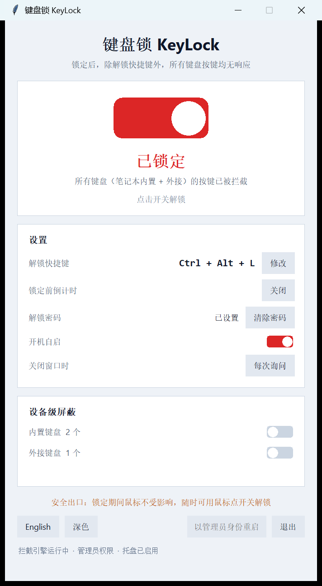
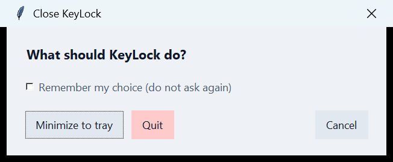

> **这份是技术向的完整手册** —— 每个设置项、工作原理、故障排查都在里面。
> 只想快速上手的话，看同目录的 `软件介绍.md` 就够了。
>
> 本文件夹里的程序就是 `KeyLock.exe`，双击运行。下面提到的 `run.bat`、
> `dist\KeyLock.exe`、`py -3 main.py` 之类，指的是旁边源码目录 `KeyLock\` 里的东西。

---
# KeyLock 键盘锁

锁定后，**除解锁快捷键外，所有键盘按键一律无响应** —— 笔记本内置键盘和外接键盘
一视同仁。界面中英文实时切换，可打包成一个 exe 免安装运行。


## 快速开始

**用打包好的 exe：** 双击 `dist\KeyLock.exe`。

**从源码跑：** 双击 `run.bat`，或者

```bat
py -3 main.py                 :: 中文
py -3 main.py --lang en       :: 英文
py -3 main.py --hotkey ctrl+alt+k
py -3 main.py --start-locked  :: 启动即锁定
py -3 main.py --minimized     :: 启动后收进托盘
py -3 main.py --dump-devices  :: 打印键盘设备清单后退出（设备级屏蔽排查用）
```

**自己重新打包：** 双击 `build_exe.bat`，产物在 `dist\KeyLock.exe`。

## 功能

### 锁定键盘
鼠标点中间的大开关，或按解锁快捷键。锁定后窗口自动置顶。

**安全出口**：锁定期间鼠标完全不受影响。哪怕快捷键被别的软件抢了，也随时能用鼠标点开关解锁。

### 解锁快捷键（可在界面里改）
默认 `Ctrl + Alt + L`，**锁定状态下依然有效**。点「修改」后直接按下想用的组合键即可
（必须含至少一个修饰键；录制期间所有按键都会被吞掉，不会漏字到别的程序；按 Esc 取消）。

### 锁定前倒计时
可选 **关闭（默认）** / 3 / 5 / 10 / 30 秒。默认关闭，也就是点开关立刻锁定；
打开之后会留一个反悔的窗口，倒数期间点开关即可取消。

### 深浅主题
点左下角那个按钮在中英文旁边切换深色 / 浅色，选择会存进配置，下次启动照旧。
浅色不是把深色反相：红/绿/黄这些强调色在浅底上压暗了一档才有对比度。
Tk 控件的颜色是创建时定死的，所以换主题的做法是**把整棵控件树重建一遍**，
而不是给每个控件记颜色角色再逐个改（漏一个就是一块颜色不对）。

### 解锁密码
设置了密码之后，解锁必须先输密码（PBKDF2-SHA256，12 万轮，只存哈希不存明文）。
**锁定状态下这个密码框照样能打字** —— 拦截器有个「密码模式」：只放行发往本程序窗口的
按键，前台一换成别的程序立刻恢复全面拦截，所以不可能借密码框把键盘解锁给别人用。

### 托盘 + 开机自启
托盘右键菜单：锁定/解锁、显示主窗口、退出。开机自启写 `HKCU\...\Run`，不需要管理员权限。

### 关闭窗口时的行为
在设置里三选一，点那一行循环切换：

| 选项 | 点了窗口的 X 之后 |
| --- | --- |
| **每次询问**（默认） | 弹一个小框，让你选「最小化到托盘 / 退出软件 / 取消」 |
| 最小化到托盘 | 直接收进托盘，程序继续在后台拦截 |
| 直接退出 | 关掉窗口就退出 |

询问框里勾上「记住我的选择」就会把结果写进配置、以后不再问；想改回来点设置里那一行就行。

界面里那个「退出」按钮和托盘菜单里的「退出」**始终是直接退出**，不会反问 —— 那是明确的退出意图。

> 顺带说一句：键盘锁着的时候点退出会先确认一次（因为退出等于解锁）。如果你设了解锁密码，
> 注意**退出软件这条路绕过了密码** —— 谁都能点退出然后键盘就恢复了。需要的话可以加一道
> 「锁定时退出也要输密码」。

### 设备级屏蔽（需管理员）
除了上面的软件拦截，还能从设备层面直接把键盘禁掉，分内置 / 外接两组独立开关。
点右下角「以管理员身份重启」提权后可用。

> ⚠️ **这一项有真实风险，用之前请读完。**
> 禁用是写进系统的，程序崩溃也依然生效。KeyLock 为此准备了三道安全绳：
> 1. **禁止全部禁用**：动手前后各检查一次，只要发现机器上会一个可用键盘都不剩，立刻原样回滚；
> 2. **落盘记录 + 启动自愈**：动过哪些设备会写进 `%APPDATA%\KeyLock\disabled_devices.json`，程序下次启动第一件事就是把它们恢复回来；
> 3. **注册表 RunOnce 兜底**：禁用期间会登记一条 RunOnce，**机器重启后下次登录时由 Windows 自动把键盘恢复回来**，哪怕你手动删了这个程序。
>
> 但有一个场景护不住：**重启后、进系统之前**的阶段（BIOS 设置、BitLocker 解锁）键盘仍然是失效的。
> 所以禁用内置键盘前请确认手边有可用的外接键盘或触屏。

## 界面说明

| 状态 | 说明 |
| --- | --- |
|  | 未锁定：灰色开关 |
|  | 已锁定：红色开关 + 滑块右移，窗口置顶 |
|  | 倒计时：黄色数字，点开关可取消 |
|  | 设备级屏蔽生效：底部红色横幅提示 |
|  | 浅色主题 · 未锁定 |
|  | 浅色主题 · 已锁定 |
|  | 关闭窗口时的三选一（深色 / 中文） |
|  | 同上（浅色 / 英文） |

英文界面见 `预览图/preview_05_en_unlocked.png`，英文浅色见 `预览图/preview_11_en_light.png`。

## 工作原理

**软件拦截**：`SetWindowsHookEx(WH_KEYBOARD_LL)` 全局低级键盘钩子。钩子回调能看到
**任何键盘**产生的每一次按键，回调返回 1 就把这次按键彻底吞掉，目标程序永远收不到。
钩子跑在独立线程的消息循环里，界面线程只负责显示，两边共享同一个 `locked` 状态。

**设备级屏蔽**：SetupAPI + CfgMgr32，`SetupDiSetClassInstallParams` + `DIF_PROPERTYCHANGE`
对键盘类的 PnP 设备做 `DICS_DISABLE` / `DICS_ENABLE`。

**内置 / 外接的判定**：实例 ID 以 `ACPI\` / `ROOT\` 开头，或父设备挂在 `ACPI\` 下（这类是
固件枚举出来的 HID 键盘，笔记本内置键盘常见挂法），或名字里带 PS/2 特征 → 内置；
`HID\` / `USB\` 且父设备是 USB → 外接。

**托盘**：ctypes 直调 `Shell_NotifyIconW`，自带线程和消息循环，图标是运行时用 GDI
动态画出来的（锁/开两套配色），不依赖任何图片文件。

## 文件

| 文件 | 作用 |
| --- | --- |
| `main.py` | 入口：命令行参数、单实例互斥体、崩溃兜底 |
| `app.py` | 控制器：把配置/引擎/界面/托盘/设备串起来，线程与命令队列 |
| `ui.py` | 界面：主窗口 + 密码对话框 + 快捷键录制对话框，含 DPI 感知 |
| `keyboard_blocker.py` | 拦截引擎：全局钩子、快捷键判定、录制、密码模式 |
| `devices.py` | 设备层：枚举键盘、启用/禁用、判定内置外接 |
| `tray.py` / `iconart.py` | 托盘图标 + 图标绘制（纯 ctypes / stdlib） |
| `config.py` | 配置持久化、密码哈希、设备禁用记录 |
| `autostart.py` | 开机自启 + RunOnce 设备恢复兜底 |
| `i18n.py` | 中英文文案表（90 条，加语言只改这里） |
| `selftest.py` | 自检，见下 |
| `build_exe.bat` | 一键打包成单个 exe |
| `devtools/` | 开发期截图验证工具（不参与打包） |
| `keylock.ico` | exe 图标，6 个尺寸 |

配置文件在 `%APPDATA%\KeyLock\`。

## 自检

```bat
py -3 selftest.py
```

100 多项断言，覆盖快捷键解析、拦截判定、录制、密码模式、配置落盘、密码哈希、
注册表自启真读真写、文案中英对齐、设备枚举、托盘生命周期、界面控件，最后跑一次
「真装钩子 + 真建窗口 + 真起托盘」的集成测试。

**它不会锁你的键盘，也不会禁用任何设备** —— 引擎会真的装上卸下，但 `locked` 始终是
`false`；设备模块只做枚举，禁用方向一次都不调用。

## 已知边界

* 仅支持 Windows。
* `Ctrl + Alt + Del` 拦不住 —— 系统安全序列，Windows 不允许用户态程序拦，这是设计如此。
* 普通权限运行时，发往「以管理员身份运行的程序」的按键可能漏过去；用管理员权限启动即可。
* 程序退出或崩溃时钩子随之卸载，键盘立即恢复正常，不会把自己锁死。
* **设备级屏蔽的「禁用」方向没有在真机上验证过**（验证会真的把键盘禁掉，风险不可接受）。
  启用 / 枚举 / 权限拦截 / 回滚这几条路径都验证过了，但第一次真的去禁用内置键盘时，
  请确保有第二个可用的输入设备在旁边盯着。
  具体没验证到的是：「禁用请求下发之后，回读设备状态能不能正确识别出『已禁用』」——
  这台机器上没有任何处于禁用状态的键盘，所以那条判定分支没有真实样本。
  真要试的时候用 `--dump-devices`（或 `dist\KeyLock.exe --dump-devices`）看设备状态，
  它会把清单打印出来并另存一份到 `%APPDATA%\KeyLock\devices_report.txt`。
* 你机器上如果装了虚拟键盘总线（比如某些手机助手类软件），那类设备会被归到「外接」组。

## 从上一版加的东西

1. 托盘图标 + 关闭窗口最小化到托盘
2. 快捷键自定义（界面里录制）
3. 设备级屏蔽（内置 / 外接分组）+ 三道安全绳
4. 锁定前倒计时、解锁密码（锁定状态下可输入）、开机自启
5. DPI 感知（150% 缩放下不再发虚）
6. PyInstaller 打包成单个 exe，单实例互斥体，崩溃弹窗兜底
