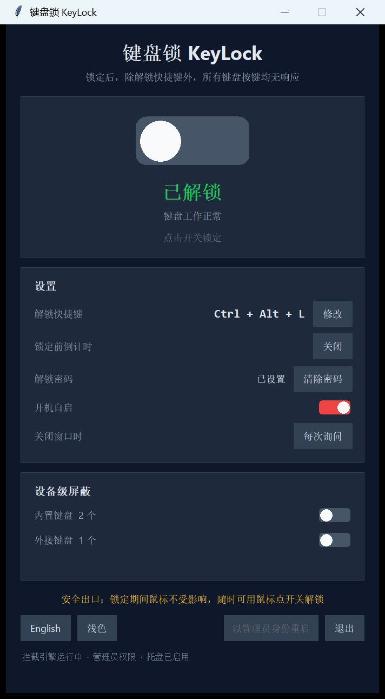
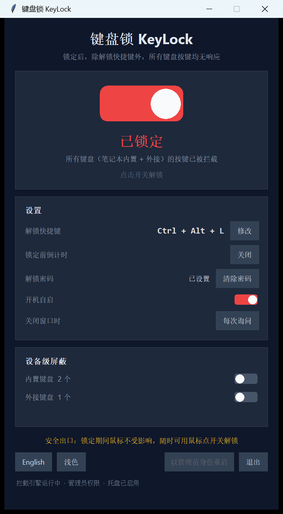
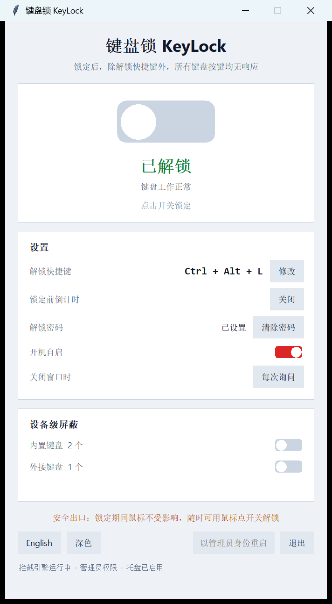
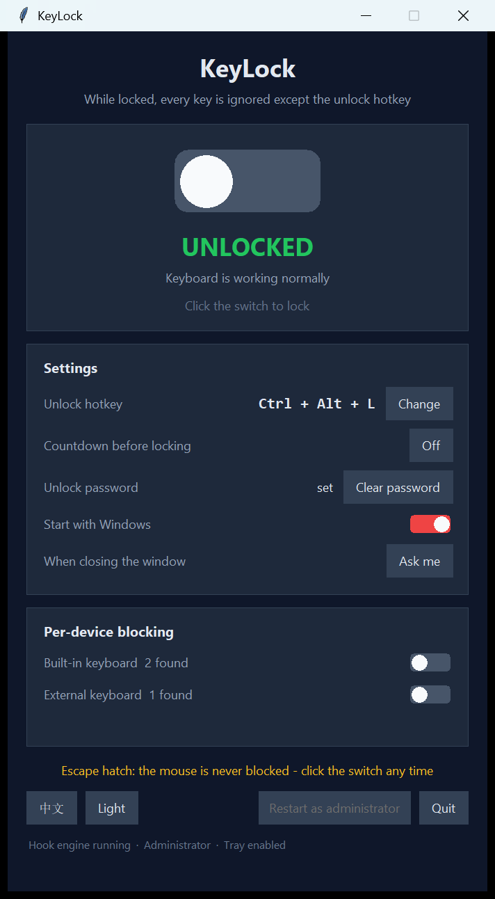
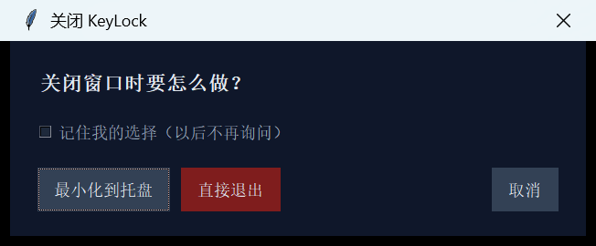

# KeyLock 键盘锁 · 软件介绍

> 一键锁死整块键盘，只留一个你自己记得住的解锁快捷键。

---

## 这是什么

KeyLock 是一个 Windows 小工具。点一下界面中间那个开关，**笔记本自带键盘和外接键盘上的所有按键会立刻失效** —— 敲什么都没反应。

但**鼠标完全不受影响**。

再点一下开关，或者按一下你设好的快捷键，键盘马上恢复。

---

## 它适合什么场景

| 场景 | 为什么用得上 |
| --- | --- |
| **擦键盘 / 清灰** | 不用关机，也不怕擦的时候误触出一堆乱码 |
| **猫踩键盘** | 离开几分钟，不怕它给你删文件或者发出一封奇怪的邮件 |
| **小孩乱按** | 鼠标还归你，键盘"借"给孩子按 |
| **跑演示、做展示** | 防止观众上台乱按 |
| **强制自己离开电脑** | 把键盘锁上，想再打字就得先解锁，多一道心理门槛 |

---

## 主要功能

| 功能 | 说明 |
| --- | --- |
| **一键锁定** | 除了解锁快捷键，所有按键一律无效 —— 字母、功能键、Win 键、音量键都一样 |
| **鼠标永远能用** | 这是最后的安全出口：快捷键万一被别的软件抢了，也能用鼠标点开关解锁 |
| **解锁快捷键可改** | 默认 `Ctrl + Alt + L`。点「修改」之后直接按下你想用的组合键就行 |
| **解锁密码** | 设了密码之后，解锁必须先输密码。锁定状态下密码框照样能打字 |
| **关闭前倒计时** | 可选 3 / 5 / 10 / 30 秒倒数，给你反悔的时间（**默认关闭，点了立刻锁**） |
| **关闭窗口时三选一** | 每次询问 / 最小化到托盘 / 直接退出，可以在界面里改 |
| **托盘图标** | 收进系统托盘继续在后台拦截，右键菜单能锁定/解锁 |
| **中英文界面** | 一键切换 |
| **深色 / 浅色主题** | 一键切换，选择会记住 |
| **开机自启** | 可选，不需要管理员权限 |
| **设备级屏蔽** | 需管理员权限。可以从设备层面单独禁掉内置键盘或外接键盘，两种分组独立开关 |

---

## 怎么用

就三步：

1. **双击 `KeyLock.exe`** —— 程序打开，键盘此时是正常的。
2. **点界面中间那个大开关** —— 键盘立刻锁上，窗口会自动跳到最前面。
3. **想解锁**：再点一下开关，或者按 `Ctrl + Alt + L`。

窗口下半部分是设置，每一行点一下就能切换，改完立刻生效。

### 界面速览

**深色主题（默认）**



**锁上之后**，开关变红、滑块滑到右边，窗口置顶



**浅色主题**



**英文界面**



**关闭窗口时会问你想怎么做**



---

## 安全设计

这类工具最怕的就是"把自己锁死"，所以 KeyLock 做了几层保险：

- **鼠标始终可用。** 这是最重要的出口，任何情况下都能点开关解锁。
- **程序一退出或崩溃，键盘立刻恢复。** 拦截功能是挂在程序进程上的，进程没了它就没了，不存在"卸载不干净"。
- **快捷键在锁定状态下依然有效。** 锁定不会把唯一的钥匙也锁进去。
- **设备级屏蔽有三道安全绳：**
  1. 不允许把所有键盘都禁掉 —— 万一判断错了，动手前后各检查一次，发现一个可用键盘都不剩就立刻原样回滚；
  2. 动过哪些设备会记在配置里，程序**每次启动第一件事**就是把它们恢复回来；
  3. 同时登记一条系统任务，**哪怕程序被删掉，下次登录 Windows 也会自动把键盘恢复**。
- **程序不会自己锁定。** 启动后一定是未锁定状态，除非你显式要求。

---

## 系统要求

- **Windows 10 / 11（64 位）**
- **免安装**：单个 `KeyLock.exe`，约 9.3 MB，双击就能跑
- 「设备级屏蔽」需要以管理员身份运行；**其它功能普通权限足够**（点界面右下角「以管理员身份重启」即可提权）

---

## 已知限制

- **`Ctrl + Alt + Del` 拦不住。** 这是 Windows 的系统安全序列，任何普通程序都拦不住，属于设计如此 —— 它也是你最后的救命键。
- **普通权限运行时**，发往「以管理员身份运行的程序」的按键可能漏过去。用管理员权限启动 KeyLock 即可解决。
- **只支持 Windows。**
- **exe 没有代码签名**，首次运行 Windows SmartScreen 可能拦一下，点「更多信息 → 仍要运行」。
- **设了解锁密码的话要注意**：「退出软件」这条路**不需要密码** —— 退出等于解锁。这是为了不让人把自己彻底困住，但也就意味着密码只能防"解锁"，防不住"退出"。

---

## 文件夹里有什么

```
键盘锁\
├── KeyLock.exe        Windows 程序本体，双击即用
├── 软件介绍.md         本文
├── 使用说明.md         Windows 版完整手册
├── 预览图\            界面截图
└── macOS版\           macOS 版（源码形式，需要装 Python）
```

| 文件 | 说明 |
| --- | --- |
| `KeyLock.exe` | **Windows 程序本体**，双击即用，免安装 |
| `软件介绍.md` | 本文 —— 这是什么、怎么用、有什么限制 |
| `使用说明.md` | Windows 版更完整的使用手册：每个设置项、工作原理、故障排查 |
| `预览图\` | 界面截图（深色/浅色 × 中文/英文 × 各种状态） |
| `macOS版\` | macOS 版。**是源码不是 .app**，需要在 Mac 上装 Python 后 `python3 main.py` 运行；详细说明和"哪些验证过、哪些没验证"见里面的 `README.md` |

> **关于手机版**：iOS 做不了 —— 系统不允许 App 拦截键盘输入，唯一的等效能力是系统自带的
> 「引导式访问」。Android 只能拦硬件键盘（用无障碍服务），屏幕上的软键盘拦不住。
> 详见 `使用说明.md` 开头。

Windows 版的完整源码、自检脚本和打包脚本在上一层的 `KeyLock\` 目录里。

